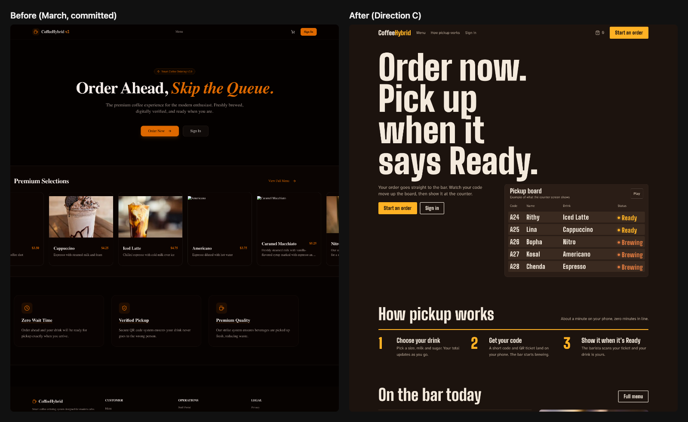

# CoffeeHybrid

**Order ahead, skip the line.** Customers order on their phone and get a pickup code; the counter board shows when it's *Ready*; staff scan the code (or type it) at pickup.

     



## What it does

**Customers**

- Browse the menu, customize size, sugar, ice and add-ons, and see the price update live
- Check out and get a **pickup ticket**: a short code plus a QR, with a countdown to pickup
- Track status (Received → Brewing → Ready → Picked up) and reorder from history

**House rules, enforced by the app**

- Orders are held for **30 minutes**, then expire (daily cron + check at pickup)
- **3 missed pickups** pause ordering for **24 hours**; browsing still works

**Staff and admins**

- Live order queue, and pickup by **QR scan or typed 4-character code** when the camera can't scan
- Admin analytics, product and category management, and an all-orders archive

## Stack

|         |                                                                                                                     |
| ------- | ------------------------------------------------------------------------------------------------------------------- |
| App     | Next.js 16 (App Router, server components), React 19, TypeScript                                                    |
| UI      | Tailwind CSS v4 tokens, shadcn/ui (Radix), lucide icons, `next/font` (Big Shoulders + Atkinson Hyperlegible Next) |
| Data    | MongoDB Atlas via Mongoose, zod validation shared by client and server                                              |
| Auth    | Auth.js (NextAuth v5): email and password plus Google, JWT sessions, role guard on every API write                  |
| State   | Zustand cart persisted to localStorage                                                                              |
| Quality | ESLint, Vitest unit tests, Playwright browser tests with axe-core accessibility checks                              |

## Quick start

```bash
npm ci
cp .env.example .env.local   # fill in MongoDB, auth secret, etc.
npm run dev                  # http://localhost:3000
```

First run, roles and seeding: see **[docs/ONBOARDING.md](docs/ONBOARDING.md)**.

| Script                                                     |                                                                         |
| ---------------------------------------------------------- | ----------------------------------------------------------------------- |
| `npm run dev`                                            | dev server on :3000                                                     |
| `npm run lint` · `npm run type-check` · `npm test` | lint, types, unit tests                                                 |
| `npm run build` · `npm run start`                     | production build and server                                             |
| `npm run test:e2e`                                       | browser tests: journey, keyboard, WCAG 2.2 AA (after `npm run build`) |

## Project structure

```
app/          routes only: (shop), (auth), staff, admin, api
features/     one folder per domain: home, menu, cart, orders, auth, staff, admin
components/   shared UI: ui/ (shadcn) and layout/ (site chrome)
server/       server-only: auth config, database, models, role guard, seed data
lib/          framework-free helpers and zod schemas
tests/        unit/ (Vitest) and e2e/ (Playwright)
docs/         audit, mockups, screenshots, onboarding, case study
```

## The redesign

This repo went through an audit → three mockups → a 12-slice rebuild. Everything is indexed in [docs/README.md](docs/README.md):

- [Audit](docs/audit/AUDIT.md) with [before screenshots](docs/screenshots/before/)
- [Mockups](docs/mockups/index.html): three directions, Direction C ("The Board") chosen
- [After screenshots](docs/screenshots/after/) and [side-by-side comparisons](docs/screenshots/compare/)
- [Case study outline](docs/CASE_STUDY.md)
- [Onboarding guide](docs/ONBOARDING.md)

## License

MIT
